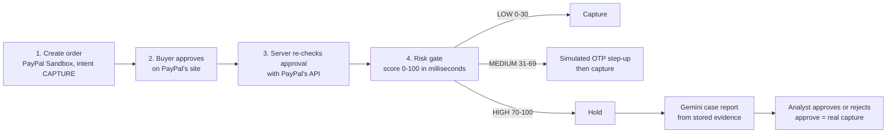

# 🛡️ PayGuard AI

**A pre-capture risk gate for PayPal Checkout.** PayGuard scores every payment *after* the buyer approves it and *before* the merchant captures it, then routes it to **auto-capture**, a **step-up check**, or **analyst review**, and explains why in plain language.

It combines transaction and behaviour checks, an **XGBoost** model with **SHAP** explanations, **PYUSD wallet-cluster detection** on Ethereum, and **Gemini-written case reports** for human analysts.

> **Prototype.** Runs against the **PayPal Sandbox** only (no real money). It uses public and synthetic data, and is **not affiliated with or endorsed by PayPal**. Risk flags are investigative leads, not proof of fraud.

---

## How it works



| Band | Score | What happens |
|---|---|---|
| **LOW** | 0–30 | Captured straight away |
| **MEDIUM** | 31–69 | Buyer must pass a step-up check (a simulated one-time code) before capture |
| **HIGH** | 70–100 | Held; an AI case report is written; an authenticated analyst approves (captures) or rejects (blocks forever) |

Ground rules the code enforces:

- **Capture is decided on the server**, from the stored decision. A caller can't send a "low score" or a "force capture" flag.
- **One decision per order, one capture per order.** This is enforced with atomic database updates plus PayPal's idempotency header.
- **Unknown is never "safe".** If wallet data, sender history or the ML model is missing, a LOW result is raised to MEDIUM.
- **Gemini never decides.** It only summarises stored evidence; the risk engine and the analyst decide.

### The six layers

| Layer | What it does | Code |
|---|---|---|
| 1. Transaction intelligence | Amount vs the sender's average, corridor risk, 24 h velocity | `backend/app/transaction_intelligence/` |
| 2. Behavioural detection | Builds the sender's history **on the server** from captured payments: known devices, known recipients, average amount | `backend/app/behavioral_detection/` |
| 3. Blockchain intelligence | PYUSD transfer graph (NetworkX); computed circular-loop and pass-through fan-out indicators with evidence | `backend/app/blockchain_intelligence/` |
| 4. Risk engine | XGBoost probability + fixed rule points + wallet points = score; SHAP explanations | `backend/app/risk_engine/`, `ml/` |
| 5. AI investigation agent | Minimised evidence pack → Gemini → validated case report (deterministic fallback) | `backend/app/investigation_agent/` |
| 6. PayPal integration + dashboard | Orders, approval, capture, verified webhooks; Streamlit dashboard | `backend/app/paypal_integration/`, `backend/app/api/`, `dashboard/` |

---

## The risk score

The score is an auditable sum. The dashboard and the PDF show every part of it:

```
score = 5 (base)
      + model points   XGBoost fraud probability x 100, capped at 40      (explained with SHAP)
      + rule points    amount spike +15, unseen device +15, new recipient +10,
                       high-risk corridor +15, high velocity +10          (fixed policy weights)
      + wallet points  circular loop +50, pass-through fan-out +40, allowlisted merchant -10
      -> clipped to 0..100
```

### Demo scenarios (real outputs)

| Scenario | What it is | Breakdown | Result |
|---|---|---|---|
| **A. Normal payment** | $45 to a familiar merchant, known device, allowlisted merchant wallet | 5 + 0 + 0 − 10 → **0** | LOW → captured |
| **B. Unusual behaviour** | $950 (11.9× the sender's $80 average), new device, new recipient, no wallet | 5 + 10.8 + 40 → **56** | MEDIUM → step-up |
| **C. Suspicious ring** | $4,800 to a wallet in a 5-wallet PYUSD loop, new device, offshore corridor | 5 + 6.7 + 55 + 50 → **100** | HIGH → hold → analyst |

---

## Machine learning (PaySim + XGBoost + SHAP)

- **Data:** [PaySim](https://www.kaggle.com/datasets/ealaxi/paysim1) (CC BY-SA 4.0), 6.36 M **simulated mobile-money** transactions. It is not PayPal data. All 8,213 fraud cases are `TRANSFER` or `CASH_OUT`, so the model is trained on those 2.77 M rows.
- **Leakage removed:** the balance columns are excluded. 97.8 % of fraud rows have `amount == oldbalanceOrg` versus 0.000 % of legitimate rows, and a live payment doesn't expose a balance anyway.
- **Features:** only what exists in both PaySim and a live payment: `log_amount`, `is_transfer`, and the recipient's prior received payments, counted from **strictly earlier hours**.
- **Time-based split:** train on hours 1–400, validate on 401–500, test on 501–743.

**Held-out test period** (124,630 rows, 2.13 % fraud):

| ROC-AUC | PR-AUC | Precision / recall* | False-positive rate* |
|---|---|---|---|
| 0.904 | 0.502 (random = 0.021) | 62 % / 34 % | 0.45 % |

\* At the threshold chosen on the validation period.

These numbers come from simulated data and **don't measure real PayPal performance**. The model's main signal is "money going to a brand-new account", which is why it's combined with rules and wallet intelligence. SHAP values are real: a test checks that they add up exactly to the model's output.

```powershell
# Retrain (needs the PaySim CSV in ml/datasets/) and re-evaluate
.\.venv\Scripts\python.exe -m ml.training.train_baseline
.\.venv\Scripts\python.exe -m ml.evaluation.evaluate_model
```

The trained model (`ml/models/risk_model.joblib`, about 0.2 MB) is committed, so the demo runs without the dataset. It is only replaced after a retrain passes validation checks.

---

## Blockchain intelligence (PYUSD)

- A wallet is linked to a payment **only when explicitly provided**: PayPal data doesn't reveal wallets.
- **Official PYUSD contract:** `0x6c3ea9036406852006290770BEdFcAbA0e23A0e8`, verified against [Paxos](https://docs.paxos.com/stablecoin/pyusd/pyusd-faq) and [PayPal](https://www.paypal.com/us/cshelp/article/what-is-paypal-usd-pyusd-HELP1005).
- **Indicators are computed from transfers**, never from labels:
  - **Circular loop:** a cycle of 6 or fewer wallets completed within 72 h (layering indicator).
  - **Pass-through fan-out:** 4+ recipients within 24 h, at least 80 % of incoming funds passed on, from at most 2 sources (mule-dispersion indicator).
- Each finding carries its **evidence**: the exact transfers, the time window and the data provenance.
- **Demo wallets are synthetic** (addresses `0xde5a…`, `tx_hash: null`).
- **Real data:** `scripts/fetch_pyusd_transfers.py` fetches real transfers via **Etherscan API V2** (Ethereum mainnet), keeping only rows from the official contract. A 100-transfer sample is in `data/real_pyusd_transfers.json`.
- **Lesson from real data:** the first fan-out rule flagged a busy real service wallet (24 payouts, only 41 % pass-through). The pass-through condition fixed that: 0 of 105 real wallets are flagged, while the synthetic mule pattern still is.

---

## Gemini investigation agent

- Gemini receives a **numbered evidence pack** (`E1`, `E2`, …) built only from stored records. It contains **no names, user IDs, device IDs, order IDs or wallet addresses**.
- Every answer is **validated**: a 1–2 sentence summary, red flags that cite real evidence IDs, and an action from a fixed list of *analyst* actions. Any wording that approves or rejects the payment is refused.
- If Gemini is unavailable or its answer fails validation, a **deterministic summary** quotes the stored evidence instead, labelled "no AI". Temporary errors are retried up to 3 times.
- The report runs in the **background**, so the payment decision is never delayed. Each report is audit-logged with the evidence **categories** sent.
- **Data-use note:** on Google's free Gemini API tier, submitted content may be used by Google to improve its products. PayGuard sends only minimised, mostly synthetic evidence. Review the provider's terms before using real data.

Model: `gemini-3.5-flash` (configurable with `LLM_MODEL`).

---

## Security

| Caller | Can do |
|---|---|
| Anyone | Health check, PayPal browser redirects, PayPal webhooks (verified with PayPal's API), wallet lookups (demo/public data) |
| Merchant key | Create order, verify approval, risk analysis, step-up, capture |
| Merchant or analyst key | Read orders, scores, alerts and webhook events; download case reports |
| Analyst key only | Approve or reject held payments. **The analyst's identity comes from the key** |

- Keys are sent in the `X-API-Key` header and compared in constant time. If no keys are configured, protected endpoints refuse every request.
- Webhooks are signature-checked with PayPal's API and processed once per event ID. A capture that happened outside the gate is flagged.
- Inputs are strictly validated. CORS allows only the dashboard origin, standard security headers are set, and errors never reveal internals.
- With `ENVIRONMENT=production`, the server refuses to start if demo mode is on or keys are missing.
- This is prototype-grade: static keys and an unencrypted SQLite database. It is **not production-certified**.

---

## Quick start (Windows PowerShell)

Tested with Python 3.14 on Windows 11.

```powershell
git clone https://github.com/Shadowscoutsolana/payguard-ai.git
cd payguard-ai
py -m venv .venv
.\.venv\Scripts\python.exe -m pip install -r requirements.txt
Copy-Item .env.example .env
```

Fill in `.env`:

| Variable | Where to get it |
|---|---|
| `PAYPAL_CLIENT_ID`, `PAYPAL_CLIENT_SECRET` | developer.paypal.com → Apps & Credentials → **Sandbox** app |
| `PAYPAL_WEBHOOK_ID` | Optional: the webhook registered on that app (needs a public HTTPS URL, e.g. a Cloudflare tunnel) |
| `GEMINI_API_KEY` | aistudio.google.com/apikey (optional: without it, reports use the deterministic fallback) |
| `ETHERSCAN_API_KEY` | etherscan.io/apis (optional, only for fetching real PYUSD data) |
| `MERCHANT_API_KEY`, `ANALYST_API_KEYS` | Generate random values (24+ characters): `.\.venv\Scripts\python.exe -c "import secrets; print(secrets.token_urlsafe(32))"`. Analysts use the format `analyst.name:KEY` |

Run the backend and dashboard in two terminals (or double-click `run_backend.bat` and `run_dashboard.bat`):

```powershell
.\.venv\Scripts\python.exe -m uvicorn backend.app.main:app --port 8000
.\.venv\Scripts\python.exe -m streamlit run dashboard\app.py
```

Open **http://localhost:8501**. API docs are at http://localhost:8000/docs (hidden in production).

**PayPal Sandbox tips**
- Create the Sandbox Business (seller) and Personal (buyer) accounts with country **United States**. Payments between two India-based accounts fail.
- Approve payments with the **Personal** account, never the seller account.
- Without PayPal credentials, orders run in a clearly labelled **MOCK** mode.

### Dashboard tabs

1. **PayPal Checkout + Risk Gate:** pick Scenario A/B/C → create order → approve on PayPal → risk analysis (score breakdown, SHAP, rule factors) → capture, step-up or hold.
2. **Interactive Graph Visualization:** the wallet cluster graph with computed indicators, an evidence table, and the real PYUSD sample.
3. **Actionable AI Investigation Queue:** held cases with the Gemini report, analyst approve/reject (paste an analyst key), and a **PDF case report** download.
4. **PayPal Webhooks & Compliance:** sends a forged webhook to show it's rejected, and lists recent payment events.

---

## API

| Method | Path | Access |
|---|---|---|
| POST | `/payments/create` | merchant |
| GET | `/payments/return`, `/payments/cancel` | public (PayPal redirect; approval re-checked with PayPal) |
| POST | `/payments/{order_id}/verify-approval` | merchant |
| GET | `/payments/{order_id}` | merchant / analyst |
| POST | `/payments/{order_id}/step-up/start`, `/step-up/verify` | merchant |
| POST | `/payments/capture/{order_id}` | merchant |
| POST | `/fraud/analyze` | merchant |
| GET | `/fraud/score/{transaction_id}` | merchant / analyst |
| GET | `/alerts` | merchant / analyst |
| POST | `/alerts/{alert_id}/review` | analyst |
| GET | `/alerts/{alert_id}/case-report.pdf` | merchant / analyst |
| GET | `/wallet-clusters/{cluster_id}`, `/wallets/ethereum/{address}/risk`, `/wallets/ethereum/{address}/graph` | public |
| POST | `/webhooks/paypal` | public (PayPal-signed) |
| GET | `/webhooks/paypal/events` | merchant / analyst |

---

## Testing

```powershell
.\.venv\Scripts\python.exe -m pytest -q                                   # offline: 278 passed, 5 skipped
$env:RUN_LIVE_TESTS = "1"; .\.venv\Scripts\python.exe -m pytest tests\test_live_services.py -v   # real services
```

- **91 %** line coverage. The offline suite never calls PayPal, Gemini or Etherscan, and uses test-only API keys.
- It includes a **full-stack test**: the real backend plus the real dashboard, running scenarios A/B/C, analyst approval and the PDF.
- Live services check the PayPal Sandbox order lifecycle, a Gemini report and an Etherscan fetch.
- **Manual Sandbox proof:**
  - Scenario A was captured automatically (capture `77Y92357DW632724T`).
  - Scenario C was held, got a Gemini report, was approved by an analyst and captured (capture `85Y243739J442351M`, confirmed `COMPLETED` by PayPal's API).

[docs/TESTING.md](docs/TESTING.md) maps every required behaviour to its tests.

---

## Project structure

```
backend/app/
  main.py                      FastAPI app, security middleware
  api/                         payments.py, fraud.py, webhooks.py
  transaction_intelligence/    Layer 1
  behavioral_detection/        Layer 2
  blockchain_intelligence/     Layer 3 (graph.py, cluster_detection.py, wallet_profile.py)
  risk_engine/scoring.py       Layer 4
  investigation_agent/         Layer 5 (anonymizer, llm_service, task_manager, case_report)
  paypal_integration/client.py Layer 6
  core/security.py             API keys, webhook/SSRF checks
  database.py                  SQLite storage and audit log
dashboard/                     Streamlit app and graph renderer
ml/                            PaySim features, training, evaluation, trained model
data/                          synthetic demo wallets and behaviour seed, real PYUSD sample
scripts/                       fetch_pyusd_transfers.py (Etherscan V2)
tests/                         offline, full-stack and opt-in live tests
docs/                          TESTING.md, team explainer PDF
```

---

## Limitations

- Sandbox and simulated data only: the model metrics come from PaySim, not real PayPal traffic. The model uses three features.
- Sender and device IDs are demo labels, not real identities or device fingerprints.
- Step-up codes are shown on screen (no SMS/email channel). In production they'd be sent to the buyer.
- Wallet links are demo inputs, wallet patterns are leads rather than proof, and addresses are pseudonymous.
- Static API keys, an unencrypted SQLite database and a single node. Scaling out would need PostgreSQL, a shared step-up secret and a job queue for reports.
- Live PayPal webhook delivery requires a public tunnel. The handler logic is fully tested with simulated PayPal responses.

## Future work

Solana and cross-chain bridge correlation, graph ML, more laundering typologies, real SMS/email step-up delivery, user accounts instead of static keys, and PostgreSQL with encryption at rest.

## Licence and data

- Code: [MIT](LICENSE).
- PaySim dataset (not included): CC BY-SA 4.0 by its authors. The trained model was derived from it.
- Real PYUSD transfers are public Ethereum data retrieved via Etherscan.
