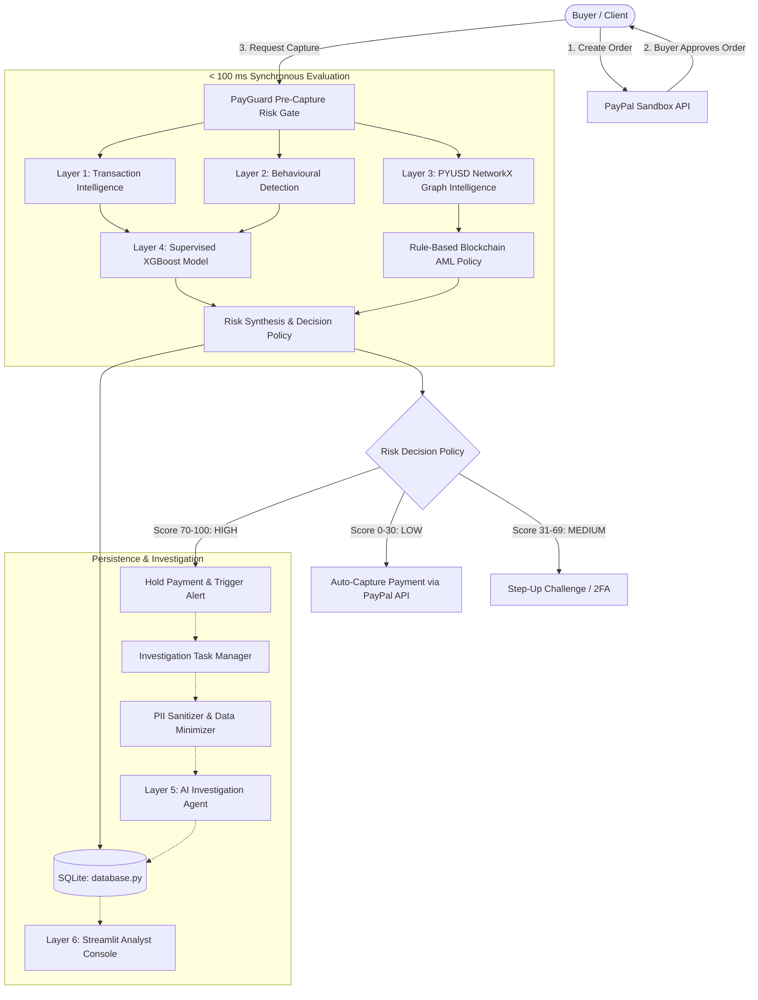

# 🛡️ PayGuard AI
> **Real-Time Pre-Capture Risk Gate & PYUSD Blockchain Intelligence for PayPal**  
> *Project Promise: PayGuard stops risky cross-border PayPal payments before capture, and explains why in plain language.*

---

## 📌 Executive Summary

Traditional fraud systems evaluate transactions *after* processing or rely on opaque machine-learning models. **PayGuard AI** introduces a lightweight **pre-capture authorization gate** between the buyer's PayPal approval and the merchant's `CAPTURE` call (Orders v2, intent `CAPTURE`). No money moves until the server-side risk gate permits capture.

By fusing **Supervised ML on Transaction Velocity (XGBoost trained on PaySim)**, **Behavioral Device Telemetry**, and an independent **Rule-Based Ethereum/PYUSD Graph Gate (NetworkX)**, PayGuard detects suspicious layering loops and mule accounts *before money leaves the platform*, delivering explainable factors synchronously under 100ms and deploying an asynchronous GenAI investigation copilot for high-risk holds.

---

## 🏛️ System Architecture



---

## 🎯 The 3 Core Demo Scenarios

| Scenario | Trigger / Attributes | Risk Score & Band | Decision Action |
| :--- | :--- | :---: | :--- |
| **Scenario A: Clean Payment** | Standard \$45 purchase, known device, verified merchant PYUSD payout address | **`5 - 20` (LOW)** | **Auto-Capture** immediately |
| **Scenario B: Behavioral Anomaly** | \$950 amount spike (11.8x baseline), new digital store, unrecognized VM device | **`50 - 65` (MEDIUM)** | **Step-Up (OTP)** challenge |
| **Scenario C: PYUSD Circular Ring** | \$4,800 transfer, recipient wallet tied to a 5-node circular transfer loop | **`90 - 99` (HIGH)** | **Pre-Capture Hold** + AI Case Brief |

---

## ⏱️ Latency & Observability SLA
- **Feature Vector Assembly:** `~10 ms`
- **In-Memory NetworkX Graph Traversal:** `~25 ms`
- **XGBoost Inference & Factor Attribution:** `~20 ms`
- **Total Synchronous Pre-Capture Gate:** **`< 60 ms` (Target SLA: `< 100 ms`)**
- **Asynchronous LLM Briefing:** `~2.2 s` (managed in background by `task_manager.py`)

---

## 📊 Dataset & Model Training (PaySim)

PaySim is a standard synthetic mobile money dataset modeling real-world financial transaction distributions.
* **Download PaySim:** Download `PS_20174392719_1491204439457_log.csv` from [Kaggle PaySim Dataset](https://www.kaggle.com/datasets/ealaxi/paysim1) and place it in `ml/datasets/` (ignored by git to keep repo size light).
* **Train Baseline Model:**
  ```bash
  python ml/training/train_baseline.py
  ```
  Exports the serialized XGBoost model to `ml/models/risk_model.joblib`.
* **Evaluate Model Performance:**
  ```bash
  python ml/evaluation/evaluate_model.py
  ```
  Computes and reports **Precision**, **Recall**, **PR-AUC**, and **False-Positive Rate (FPR)**.

---

## 🚀 Quick Start Guide

### 1. Installation
Clone the repository and install requirements:
```bash
git clone https://github.com/your-username/PayGuard-AI.git
cd PayGuard-AI
pip install -r requirements.txt
```

### 2. Configure Environment
Copy `.env.example` to `.env`:
```bash
cp .env.example .env
```
*(Note: If PayPal or Gemini credentials are not set, PayGuard automatically runs in resilient demo/sandbox mode with full mock telemetry).*

### 3. Start the Backend API
Double-click `run_backend.bat` or run:
```bash
uvicorn backend.app.main:app --reload --port 8000
```
* API Documentation: [http://localhost:8000/docs](http://localhost:8000/docs)
* Health Check: [http://localhost:8000/health](http://localhost:8000/health)

### 4. Launch the Streamlit Operations Dashboard
Double-click `run_dashboard.bat` or run:
```bash
streamlit run dashboard/app.py
```
Open [http://localhost:8501](http://localhost:8501) in your browser.

---

## 📁 Repository Structure

```
├── backend/
│   ├── app/
│   │   ├── main.py                     # FastAPI application & latency middleware
│   │   ├── config.py                   # Pydantic configuration settings
│   │   ├── schemas.py                  # API schemas & data contracts
│   │   ├── database.py                 # SQLite storage (transactions, alerts, events, audit)
│   │   ├── core/
│   │   │   └── security.py             # API security, SSRF validation, constant-time compare
│   │   ├── api/
│   │   │   ├── payments.py             # PayPal order create & capture routes
│   │   │   ├── fraud.py                # Pre-capture risk gate & alert review routes
│   │   │   └── webhooks.py             # Official PayPal webhook listeners & verification
│   │   ├── transaction_intelligence/   # Layer 1: Velocity & corridor calculations
│   │   ├── behavioral_detection/       # Layer 2: Device anomaly & history baselines
│   │   ├── blockchain_intelligence/    # Layer 3: NetworkX graph & mule cluster detection
│   │   ├── risk_engine/                # Layer 4: Multi-model scoring & SHAP factors
│   │   ├── investigation_agent/
│   │   │   ├── anonymizer.py           # Layer 5: PII sanitizer & data minimizer
│   │   │   ├── llm_service.py          # Layer 5: LLM executive case briefs
│   │   │   └── task_manager.py         # Layer 5: Async background investigation runner
│   │   └── paypal_integration/         # Layer 6: PayPal Orders v2 REST client
├── dashboard/
│   ├── app.py                          # Streamlit UI with graph visualizer & queue
│   └── graph_viz.py                    # Interactive PyVis color-coded graph renderer
├── data/
│   └── demo_wallets.json               # PYUSD demo clusters marked as synthetic/real_fetched
├── ml/
│   ├── models/                         # Serialized XGBoost models (risk_model.joblib)
│   ├── preprocessing/features.py       # ML feature transformation pipelines
│   ├── training/train_baseline.py      # PaySim tabular XGBoost training script
│   └── evaluation/evaluate_model.py    # Measures Precision, Recall, PR-AUC, and FPR
├── scripts/
│   └── fetch_pyusd_transfers.py        # One-off Etherscan PYUSD transfer ingestion utility
├── tests/
│   ├── test_risk_engine.py             # Validates the 3 demo scenarios
│   ├── test_graph_engine.py            # Validates NetworkX cycle detection
│   ├── test_cluster_detection.py       # Validates PyVis rendering & AML cluster rules
│   └── test_database.py                # Validates SQLite CRUD & audit logging
├── run_backend.bat                     # Windows batch runner (quotes spaces & %~dp0)
├── run_dashboard.bat                   # Windows batch runner (quotes spaces & %~dp0)
├── requirements.txt
├── .env.example
├── .gitignore
└── README.md
```

---

## ⚖️ Honest Disclosures & Fintech Compliance Guardrails
- **Data Provenance:**
  - **PaySim:** Synthetic mobile-money dataset used for tabular baseline feature distributions.
  - **Demo Wallets:** Handcrafted synthetic Ethereum/PYUSD transfer topologies labelled with explicit `synthetic` or `real_fetched` provenance. For real-chain queries, see `scripts/fetch_pyusd_transfers.py`.
- **Explainability Focus:** The LLM does **not** make capture/block decisions; it only writes case summaries for human compliance officers. The quantitative score is produced by the deterministic risk engine.
- **Privacy Assurance:** All PII is stripped and IDs are pseudonymized before sending evidence to LLM endpoints.
- **Pseudonymous Public Graph:** Graph proximity and cluster flags represent investigative leads, not absolute proof of fraud.
